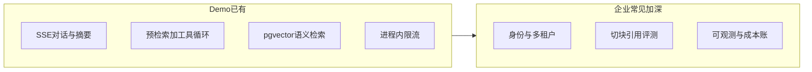
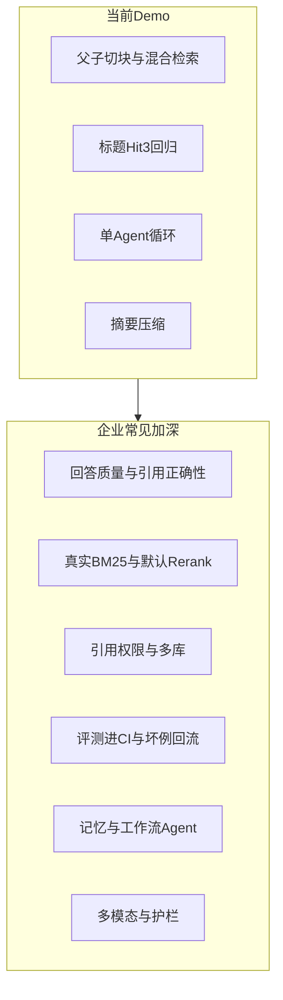

# 与企业级 AI 项目对照：当前还缺什么

> 本文对照企业内部知识助手 / RAG 平台的常见能力，说明本 Demo 已经覆盖什么、功能上还差哪一层、工程上还差哪一层。不是实现清单，也不要求一次补齐。

本仓库是教学闭环：对话、Agent、单库 RAG、Prompt 实验室、A/B 裁判都已跑通。企业级差距分两层：

- **深入功能**：同一条 AI 链路上，企业产品会再做厚的能力（本文重点）。
- **工程纪律**：登录隔离、安全、测试、可观测、迁移。没有这些，深入功能也很难安全地给多人用。

当前能力边界：

- 知识按父子块存储，只对子块做向量；Agent 回答可点开来源（[RAG知识工程](./RAG知识工程.md)）
- Agent 先规划再执行；三个工具统一超时 15 秒、失败重试一次，同一轮 `tool_calls` 并行，单循环最多 8 轮（[tools.js](../server/src/agent/tools.js)、[agent.service.js](../server/src/agent/agent.service.js)）
- 对话和 Agent 都是最近 6 条原文加早期摘要，并按当前问题召回相关历史和跨会话事实（Memory RAG）。Agent 本轮工具结果不进摘要，也不进记忆；摘要失败则退回最近 10 条（[chat.js](../server/src/routes/chat.js)、[agent.js](../server/src/routes/agent.js)、[memory.js](../server/src/memory/memory.js)）
- Agent 回答带可点击引用；回答回归检查结论是否贴着父块、编号是否对得上

相关实现说明见 [后端开发指南](./后端开发指南.md)、概念见 [AI学习指南](./AI学习指南.md)。这些缺口要补哪些知识、先学哪一块，见 [企业级落差与知识补齐](./企业级落差与知识补齐.md)。

---

## 一、已经具备

- 业务闭环：Chat Completions、Function Calling、Embedding、预检索 RAG、流式中断。
- 存储：PostgreSQL + pgvector（HNSW）、会话事务写入、JSON 种子迁移。
- 运维雏形：`/api/health` 探库、进程限流、`trust proxy`、优雅关闭、Sealos 文档、`docker-compose` 起库。
- 产品实验：Prompt 在线编辑、messages 预览、参数滑块、A/B + LLM-as-judge。

差距主要不在「会不会调模型」，而在知识怎么用、答案能不能追溯、质量能不能回归，以及谁能用、出事怎么查。

---

## 二、深入功能缺口

### 1. RAG 知识工程（最大功能落差）

| 企业常见 | 当前项目 |
|----------|----------|
| PDF/网页/仓库入库、异步解析 | 可上传 pdf、docx、pptx、html、md、txt、csv，也可提交网页或公开 Git 仓库。原文进腾讯云 COS，解析在后台进行。详见 [RAG知识工程](./RAG知识工程.md) |
| 切块（按标题/语义/重叠窗口） | 父子切片：父块按标题合并自然段，子块约 250 字并重叠。详见 [RAG知识工程](./RAG知识工程.md) |
| 混合检索 BM25 + 向量，再 Cross-Encoder Rerank | 子块关键词 + 向量，RRF 融合后展开父块。配置 `RERANK_MODEL` 时再二排 |
| 答案带 chunk 引用、原文高亮、过期文档降权 | Agent 回答带 `[n]` 和来源卡片，父块里高亮命中子块。更新时间只在融合分相同时再比较 |
| 多知识库、元数据过滤（部门/密级/时间） | 仍是一张 `kb_entries`。检索可带 `category` |
| Query 改写 / HyDE / 多路召回 | 有上一轮对话时，把追问改写成独立问句。无 HyDE |
| Graph RAG、FAQ 与非结构化分流 | 无 |

切块、引用、文件 / 网页 / 仓库入库已经接上。对话和 Agent 都检索知识库，问候除外。Graph RAG 还没有。网页只抓用户提交的单个地址，不会顺着链接再爬。

### 2. Agent 编排深度

现状：循环前先给出要调用的工具和原因，再进入 ReAct；预检索仍在。同一轮多个 `tool_calls` 并行。每个工具超时 15 秒，失败再试一次，本轮再失败就停用该工具。工具仍是搜知识库、查 npm、本地代码统计。

还缺：危险操作人工确认、多 Agent 分工、持久化技能 / MCP 插件、代码执行沙箱、浏览器/内部系统只读 API、失败补偿。`analyze_code` 只做正则统计，不是 AST / 安全扫描。停用只在这一轮任务内，没有跨请求熔断。

### 3. 记忆与上下文

现状：对话和 Agent 都是最近 6 条原文 + `sessions.summary`，再按当前问题从 `memories` 召回。回合记忆跟着会话走；用户说出姓名、偏好、技术栈或约定时，会抽成不绑会话的事实，换一个对话也能召回。Agent 本轮 `tool` 消息不进摘要，也不进记忆。摘要失败退回最近 10 条。召回明细在消息预览里。

还没有：会话分支、精确 tokenizer 动态摘要、多模态上下文（图/语音）。前端 `view` 存在组件 state 里，刷新即丢，也没有会话分享/导出。

### 4. 质量闭环（比单次 A/B 更深）

现状：CompareLab 一次两路 + 四维裁判（[judge.service.js](../server/src/services/judge.service.js)）。检索黄金集 `npm run eval:rag` 按线上同一条混合检索打 Hit@3，不调用对话模型。回答回归 `npm run eval:answer` 用同一条检索生成答案，再检查忠实和引用编号。Agent 回答可标有用或无用；无用需人工确认后才进入 `server/eval/feedback.json`，两套脚本跑完种子集再带上它。检索回归在 GitHub Actions 里跑，需要仓库 Secret `DASHSCOPE_API_KEY`。回答回归仍手动跑。

企业要：RAGAS、人工抽检队列、Prompt/知识库版本与回滚、坏 case 自动入库。点踩不会自动改种子集。改一条知识或换 embedding 后，检索回归会在流水线里拦，回答回归仍要自己跑。

### 5. 生成侧产品功能

- 结构化输出（JSON Schema / 表格落库），不仅是 Markdown 聊天。
- 护栏：注入检测、主题越权、敏感词、工具出站策略。
- 流式中的「可引用片段」与中断后续写。
- 多模型路由（简单题 turbo、难推理 max）、缓存语义相同问题。
- 语音输入输出、看图（Qwen-VL）——[AI学习指南](./AI学习指南.md) 进阶方向已写，产品未做。

### 6. 知识库作为产品本身

同一文件按内容指纹去重，同一网页地址也只保留一条未失败记录。知识库页能看到哪篇被引用最多、哪篇出现在无用回答里、哪篇从未引用。权限、审批发布、新鲜度、目录树、全文检索控制台仍未做。当前是单用户 CRUD + 检索对比教学面板。

---

## 三、工程缺口（功能之外）

没有登录时，[history](../server/src/routes/history.js) / [knowledge](../server/src/routes/knowledge.js) / [prompts](../server/src/routes/prompts.js) **全库共享**，谁都能删别人的会话和知识条目。

| 缺口 | 现状 | 企业常见 |
|------|------|----------|
| 身份与隔离 | 无登录 | OIDC/JWT、RBAC、行级 `org_id` |
| 安全基线 | [`cors()` 全开放](../server/src/app.js) | 白名单、Helmet、schema 校验、密钥托管、审计 |
| 测试与 CI | 无自动化测试 | 单测 + 集成 + SSE 契约 + PR 流水线 |
| 可观测与成本 | `console.log`；`usage` 挂在单条消息 | requestId、Tracing、按租户 token 账单、日配额 |
| 限流 | 进程内存 `express-rate-limit` | 多实例需 Redis |
| Schema 演进 | `CREATE TABLE IF NOT EXISTS` | 版本化 migration；换 `EMBEDDING_DIM` 需重建 |
| 列表 | `listEntries` 全表拉取 | 分页 |
| 交付形态 | 仅库的 compose | 应用镜像、多环境、OpenAPI |

---

## 四、建议优先级

教学项目不必做成中台。两条路线可以分开走。

**若目标是功能上更像企业内部知识助手：**

1. 文档上传 + 切块入库 + 回答带引用（已做，见 [RAG知识工程](./RAG知识工程.md)）
2. 关键词 + 向量混合检索，可选 Rerank（已做。关键词仍是子串匹配）
3. 固定问答集上的检索 Hit@3，以及回答是否忠实、引用是否对（已做，见 [RAG知识工程](./RAG知识工程.md)）。检索回归已进 CI，回答回归仍是手动跑
4. 用户反馈（有用/无用）写入库，确认后进入补充评测集（已做）
5. Agent 工具超时、并行调用、先规划再执行（已做）。写操作的人工确认还没有，因为目前没有写操作工具

切块、引用、检索回归和回答回归已经有了。对话和 Agent 都会先检索。超长父块在回答时只取命中附近约 1000 字，没有重新向量化。Agent 会先规划，工具有超时和重试，同一轮调用会并行。无用回答可以收回评测集，做法见下面。登录隔离、BM25、多 Agent 仍留着。

### 无用回答收回评测集（已做）

对话和 Agent 的回答下方都有「有用 / 无用」。无用可附一句原因。只挂在已经落库的回答上。刷新后还在。

每条反馈记下：会话和回答、用户原问、预检索改写后的问句（写在 `messages.retrieval`）、命中父块、回答正文、embedding 模型名、判定、原因、时间。

知识库页「无用回答」列出这些记录。确认期望的父文档标题，或标成知识库不该命中，再点「收进检索集」或「收进回答集」。结果追加到 `server/eval/feedback.json`，不改 `golden.json` 和 `answer.json`。点踩不会自动入库。

`npm run eval:rag` 与 `npm run eval:answer` 先跑种子集，再跑这份补充集。检索回归进了 GitHub Actions（`.github/workflows/eval-rag.yml`），只跑 `eval:rag`。回答回归会调模型，仍手动跑。流水线需要仓库 Secret `DASHSCOPE_API_KEY`，否则向量路没有结果。

知识库页「文档用量」按父文档列出被引用次数、出现在无用回答里的次数和最近引用时间，并单独列出从未引用的已入库条目。数字来自已落库的来源卡片，打开页面时重算。向量化到检索对比收在「检索与评测」里，默认收起。

### 下一步完善

仍走知识助手。没有 embedding 额度之前，不重新切块，也不重新向量化。学习顺序见 [企业级落差与知识补齐](./企业级落差与知识补齐.md) 第五节。

| 顺序 | 做什么 | 做到这样算完成 | 会不会调模型 |
|------|--------|----------------|--------------|
| 1 | 读文档用量，先判断「从未引用」是没人问，还是问了也召不回 | 「事件循环」「SSR 服务端渲染」已在 `server/eval/golden.json`，对话里还没人问到，所以用量是 0。先读「技术点积累」的原文，确认它该被哪类问题命中，再决定要不要补一道检索题 | 不调 |
| 2 | 来源卡片标明这段摘录被截过 | 父块超过约 1000 字时，卡片上能看出这是命中子块附近的一段。短条目不出现这个标记。已经落库的旧回答保持当时的长摘录 | 不调 |
| 3 | 有额度后再重切长文 | 《你不知道的JavaScript（上卷）》和《WEB前端开发面试题汇总(1)》按约 1000 字父块、约 250 字子块重新入库。`npm run eval:rag` 仍通过 | 要 embedding |

先不做：登录、请求校验、BM25、多 Agent、Graph RAG、写操作的人工确认、把回答回归放进每次提交。小团队内网要先做的，仍是下面这一列。

**若目标是能给小团队内网用：**

1. 登录 + 数据按用户隔离
2. 请求校验 + CORS / Helmet
3. 版本化 SQL 迁移 + 列表分页
4. 结构化日志 + token 用量汇总
5. 冒烟测试 + CI（lint / test / build）

完整企业级还要合规、SLA、多活和平台化 RAG，那是另一条产品线。当前代码作为教学闭环是够的。
