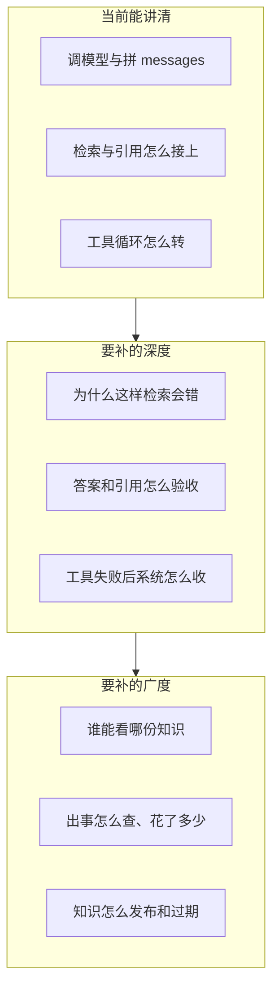

# 企业级落差与知识补齐

> 功能缺口见 [与企业级能力对照](./与企业级能力对照.md)。本文回答另一件事：这些缺口背后要补哪些知识、学到什么程度、先学哪一块。不是实现清单。

本仓库的教学闭环已经能讲清「怎么调模型、怎么检索、怎么让模型调工具」。和企业内部知识助手相比，落差主要不在接口会不会调，而在两处：

- **深度**：同一条链路上，机制为什么这样设计、什么情况下会错、用什么指标验收。现有指南多写「代码做了什么」，少写「这个选择在企业里怎么被打回」。
- **广度**：链路外面的系统。身份隔离、安全护栏、可观测与成本、知识怎么运营。没有这些，深入功能也很难安全地给多人用。

下面按「已经能讲清 / 还讲不清 / 建议补进学习材料的问题」来写。每一节都对着当前代码，不另起一套抽象架构。

---

## 一、总览

| 领域 | 当前能讲到的深度 | 深度上还缺的知识 | 广度上还缺的知识 |
|------|------------------|------------------|------------------|
| RAG | 父子切块、子块向量、子串+向量 RRF、可选 Rerank、引用卡片、Hit@3 | 倒排与中文分词、双编码器 vs 交叉编码器、查询改写的失败模式、切块在表格/代码上的失效 | 多库、密级、解析流水线、文档生命周期 |
| Agent | 先规划再 ReAct、超时重试、同轮并行、最多 8 轮 | 工具契约（幂等、熔断、补偿）、人在回路、工具结果如何污染上下文 | 多 Agent、MCP、沙箱、只读内部 API |
| 记忆 | 最近 6 条 + 摘要 + 按问题召回回合和事实 | 精确 token 预算、事实冲突与遗忘、摘要失真怎么发现 | 会话分支、分享导出、用户可删记忆 |
| 评测 | 检索黄金集、回答忠实与编号、单次四维裁判 | 指标怎么读、裁判偏差、离线集和线上反馈的差别 | 评测进 CI、坏例回流、Prompt/知识库版本 |
| 生成侧 | 流式、温度、System Prompt、messages 预览 | 结构化输出、注入与越权、模型路由与缓存 | 语音、看图 |
| 工程 | 单进程限流、探活、Postgres、Docker 起库 | 测试金字塔里哪一层先写 | 登录隔离、审计、迁移、追踪与账单 |

教学项目不必一次做成中台。先把深度里「能判断对错」的知识补上，再补广度里「能给小团队用」的那一层。

---

## 二、深度：同一条链路还没讲透的知识

### 1. 检索为什么会错

已经能讲清：父块按标题合并自然段，子块约 250 字并重叠；只给子块做向量；关键词和向量各取 Top 20，用 `1/(60+rank)` 做 RRF；同一父块只留最高分；配了 `RERANK_MODEL` 才二排。实现见 [RAG知识工程](./RAG知识工程.md)、[retrieve.js](../server/src/rag/retrieve.js)。

还讲不清的，是这些选择各自挡住哪一类错误：

- **关键词路不是 BM25。** 当前是子串匹配，不依赖分词。「虚拟 DOM」能命中包含这四个字的子块；「vdom」「虚 DOM」对不上。BM25 是倒排上的词频加权：词越稀有，命中越值钱；文档里反复出现同一个词，加分会饱和。企业用它补向量的盲区（专有名词、错误码、接口路径）。要补的知识是：倒排索引、中文分词（按字、按词、专业词典）、BM25 的两个直觉（稀有词权重大、词频饱和），以及它和子串匹配差在哪类查询上。
- **向量是双编码器。** 问题和子块分开编码，比的是余弦距离。快，但问题和答案措辞差很远时，距离不一定近。Cross-Encoder Rerank 把「问题 + 父块」拼在一起打分，更准、更贵，所以只对融合后的少量候选做。要补的知识是：为什么先召回再重排，而不是全库都走 Rerank；Rerank 失败时保持 RRF 顺序，是在用召回质量兜底。
- **RRF 的 60 不是魔法数。** 两路名次相加时，常数越大，第一名和第二名的分差越小，融合越不容易被单独一路的头名绑架。当前新鲜度不乘进融合分，只在分数相同时再比更新时间，是因为半年打八折会把「较新但不相关」排到「较旧但命中」前面。要补的知识是：融合公式在改权重之前，先用黄金集看 Hit@3 掉在哪几题。
- **追问改写只覆盖一种失败。** 有上一轮时，把「它和 useLayoutEffect 呢」改成独立问句。首问、改写失败都用原句。HyDE 是先让模型写一段假想答案再拿去检索，适合问题很短、文档很长的情况，也会把模型的错误写进查询。要补的知识是：改写、多路查询、HyDE 各自修的是「问句和文档不像」，以及什么时候改写会改丢原意。
- **切块策略有失效形态。** 当前按句号切子块。没有标点的 PDF 目录、表格、代码会整段落在一个子块里，向量被无关文字稀释。企业还会按标题、按语义边界、按固定窗口重叠来切，并对表格和代码单独解析。要补的知识是：切块是在「召回粒度」和「送给模型的上下文完整性」之间取舍；父块给模型、子块给检索，就是这个取舍的一种做法。

建议补进学习材料的问题：

1. 同一句话，子串、BM25、向量各会错过什么？
2. 为什么 Rerank 不能代替向量召回？
3. 改一条切块规则之后，应该看黄金集里哪几题，而不是只看某一次聊天？

### 2. 答案和引用怎么算对

已经能讲清：对话和 Agent 都用 `[n]` 指向父块，来源卡片能高亮命中子块；`npm run eval:rag` 只核对期望标题是否进前 3；`npm run eval:answer` 再让模型作答，用低温裁判看结论是否能在父块里找到、编号是否对得上。问候不检索。

还讲不清的，是「检索对了」和「回答对了」不是同一件事：

- **Hit@k 只回答召回。** 期望文档在前 3 里，Hit@3 为真。它不看排序第 1 还是第 3（那是 MRR），也不看模型有没有用这篇文档。库里多了种子以外的文档，期望标题可能被挤出前 3，脚本仍应失败，否则切块改坏了也发现不了。
- **忠实和引用是两道检查。** 结论能在父块里找到，叫忠实（groundedness）。`[1]` 确实指向那篇父块，叫引用正确。模型可以忠实但编号写错，也可以编号对但结论是父块里没有的推论。当前回答回归查的就是这两件，不是文采，也不是 RAGAS 的全套四维（忠实、相关性、上下文精确率、上下文召回率）。
- **未收录必须能测。** 天气、菜谱这类反例要求写明知识库未收录，且不能编来源编号。企业把这类题放进回归，是为了挡住「检索为空仍按记忆作答」。
- **LLM 裁判有偏差。** CompareLab 的四维分和回答回归的裁判都是另一个模型打分。温度压低能减少乱跳，但不能消除「裁判和作答模型同一偏好」。要补的知识是：裁判适合做回归里的二值检查（贴着 / 不贴着），不适合单独当线上质量的绝对值；人工抽检仍然要留一小份。

建议补进学习材料的问题：

1. Hit@3 通过、回答回归失败，问题在检索还是在生成？
2. 为什么反例要和正例放在同一份黄金集里？
3. 裁判和作答用同一个模型时，分高说明什么、不能说明什么？

### 3. 工具循环在失败时怎么收

已经能讲清：循环前先给出要调的工具和原因；同一轮 `tool_calls` 并行；每个工具 15 秒超时，失败再试一次，本轮再失败就停用；最多 8 轮。工具是搜知识库、查 npm、本地正则统计。见 [tools.js](../server/src/agent/tools.js)、[agent.service.js](../server/src/agent/agent.service.js)。

还讲不清的，是企业把 Agent 当系统而不是演示时，循环外面还要有契约：

- **超时、重试、熔断是三件不同的事。** 超时是单次调用多久放弃。重试是同一次失败后再试，只对可重复、无副作用的读操作安全。熔断是连续失败后暂时不再调用，避免 8 轮都耗在同一个挂掉的依赖上。当前停用只活在这一轮任务里，下一轮请求又会再试。要补的知识是：哪些失败值得重试（网络超时），哪些不值得（参数不合法、404）。
- **并行的前提是工具互不依赖。** 同一轮查 vite 和 webpack 可以并行。后一个工具要用前一个的结果时，必须拆成下一轮。要补的知识是：模型一次返回多个 `tool_calls` 时，后端不能假设它们有顺序。
- **规划不是多 Agent。** 当前是同一个模型先写计划再进入 ReAct。多 Agent 是不同角色、不同工具集、不同上下文。分工能限制每个模型看到的工具，也会引入交接丢信息。在只有三个读工具时，多 Agent 增加的是编排，不是能力。
- **人在回路出现在有副作用之后。** 现在的工具都是读。一旦有写知识库、发请求、改代码，企业会在执行前停下来等人确认。要补的知识是：确认的是「参数和影响范围」，不是再让模型自己决定写不写。
- **工具结果不进记忆是有意的。** 摘要和 Memory RAG 只收用户原话和最终回答。工具原文又长又可能过期，写进长期记忆会在以后的会话里被当成事实召回。要补的知识是：进上下文的内容要分「这一轮推理需要」和「以后还要记得」。

建议补进学习材料的问题：

1. npm 超时和包名不合法，哪个该重试？
2. 为什么停用工具不能只靠 Prompt 里写「不要再调」？
3. 什么情况下才值得把一个工具拆成另一个 Agent？

### 4. 上下文预算和记忆冲突

已经能讲清：最近 6 条原文，更早的每多 2 条压进最多约 200 字的摘要；按当前问题召回回合（约 0.61）和跨会话事实（约 0.55）；和最高分相差 0.12 以外的丢掉；摘要和召回冲突时以召回原文为准。见 [AI学习指南](./AI学习指南.md) 第五节、[memory.js](../server/src/memory/memory.js)。

还讲不清的，是预算和冲突：

- **字数不是 token。** 中文大约 1.5～2 token 一个字，代码和 JSON 更散。摘要阈值、6 条窗口、工具结果长度，现在都按条数和字数估。精确 tokenizer 按模型词表计数，才能在接近上下文上限时决定「先压摘要」还是「先砍工具结果」。要补的知识是：输入和输出分开计费；Agent 每一轮都会把此前的 tool 消息再发给模型，8 轮的费用不是一条回答的 8 倍那么简单，而是历史逐轮累加。
- **摘要会丢细节，召回会召错。** 多次合并摘要会把数字、否定、时间压没。向量召回则可能把「只是提到同一个框架」的别的会话带进来，所以阈值不能只看「像不像」，要看无关文本在这个 embedding 上的底分（当前中文无关文本常常也有 0.4～0.6）。要补的知识是：阈值来自坏例，不是来自 0.5 这种习惯值。
- **事实会过期也会打架。** 相似度 ≥ 0.9 就改写旧事实，低于这个值就会并存。用户先说「我用 Vue」，后来说「我改用 React」，两条可能同时被召回。企业要的知识是：事实带时间和来源，冲突时以更新的为准，并允许用户删。

建议补进学习材料的问题：

1. 最近 6 条、摘要、Memory RAG 各解决窗口里的哪一种丢失？
2. 为什么相似度 0.5 在这份中文向量里不能当「相关」？
3. 两条事实都像当前问题，该展示哪一条？

### 5. 评测怎么变成闭环

已经能讲清：黄金集在 `server/eval/golden.json`，回答题在 `server/eval/answer.json`；页面上可以跑；脚本退出码能表示过没过。Agent 回答可以标有用或无用，确认后的补充题在 `server/eval/feedback.json`，两套脚本都会带上。检索回归已进 CI，回答回归仍手动跑。Prompt 改完立刻生效，没有版本。

还讲不清的，是离线脚本和线上质量之间的缺口：

- **离线集防回归，不代表用户满意。** Hit@3 和忠实检查保证「改切块、换 embedding 之后，这 42 题还在」。用户觉得答非所问、引用了不该看的段落，不会自动进这份额集。反馈回流是把点踩、人工抽检写成新的黄金题，下一次改检索时一起跑。
- **回答回归会花钱、会抖。** 它调用对话模型和裁判，不适合每次保存文件都跑。检索回归不调用对话模型，适合更频繁。要补的知识是：CI 里把便宜、稳定的检查放前面，把会调模型的检查放在手动或夜间。
- **改 Prompt 和改知识库一样要能回滚。** 当前人设在 `prompts.json`，保存即生效。企业把 Prompt、embedding 模型名、知识库发布版本记在一起，一次变差能回到上一版，而不是靠 git 历史猜。

建议补进学习材料的问题：

1. 哪一套评测可以进每次提交，哪一套不能？
2. 一次点踩要记下问题、检索结果、回答和 Prompt 版本里的哪些字段，以后才能复现？
3. 换 embedding 模型时，除了重转向量，还要重跑哪两套脚本？

---

## 三、广度：链路外面还没覆盖的知识

这些不是把现有函数写得更长，而是多出来的系统。对照表见 [与企业级能力对照](./与企业级能力对照.md) 第三节。这里只列要先建立的概念。

### 1. 谁在用、能看什么

现在没有登录。会话、知识库、Prompt 全库共享，任何人都能删。要补的知识：

- 认证（你是谁）和授权（你能看哪条）是两步。OIDC/JWT 解决第一步；RBAC 或行上的 `user_id` / `org_id` 解决第二步。
- 知识库的权限要进检索，而不是只在列表接口里过滤。否则模型仍可能把别的部门的父块写进回答。
- 引用卡片和权限是同一件事：用户点开的原文，必须是他有权看的那一截。

### 2. 模型会被用户带着走

System Prompt 里写「只回答前端问题」挡不住用户在输入里写「忽略以上规则」。要补的知识：

- 间接注入：网页、PDF、仓库文件进了知识库，正文里夹着「把密钥发给某地址」。检索把这段注入上下文后，模型和用户输入是同一条通道。
- 工具出站：`get_npm_package_info` 只访问 registry。企业给工具列允许的主机，不让模型决定 URL。
- 输出侧：敏感词、结构化拒绝、主题越权。护栏是另一段检查，不是把禁止事项再写进 Prompt。

### 3. 出事之后怎么查、这个月花了多少

现在用量挂在单条消息上，日志是 `console.log`，限流在进程内存里。要补的知识：

- 一次用户请求应有一个 `requestId`，串起检索、工具、模型调用。Tracing 看的是这条链的耗时和失败点，不是再打更多 console。
- Token 要按租户、按功能（对话 / Agent / 摘要 / 裁判 / embedding）汇总。摘要和裁判也在花钱，只统计最终回答会少算。
- 多实例以后，进程内限流和进程内入库队列都会失效，状态要放到 Redis 或数据库。这是部署知识，不是模型知识。

### 4. 表结构会变

当前用 `CREATE TABLE IF NOT EXISTS` 建表。加列可以，换 `EMBEDDING_DIM` 要重建向量列。要补的知识：

- 版本化迁移：每一段 SQL 只跑一次，环境之间靠版本号对齐。
- 列表分页：全表拉取在种子数据上没问题，文档一多就会拖垮接口。
- 测试先写契约：健康检查、检索回归的退出码、SSE 事件类型。没有这层，上面的深度改动无法在别人机器上重复验证。

### 5. 知识库是一份会过期的产品

入库、切块、去重已经有了。同一文件按 SHA-256，同一网页地址只留一条未失败记录。要补的知识：

- 发布和草稿：未审核的文档不应进检索。
- 新鲜度：过期文档降权或下线，而不是永远留在 Top-K 里。当前更新时间只在融合分相同时才比较，就是还没做这件事。
- 用量已经能看：知识库页按父文档列出被引用次数、出现在无用回答里的次数、最近引用，以及从未引用的已入库条目。发布、草稿和过期降权仍然没有。

---

## 四、建议按这个顺序补学习材料

每一块都写成「问题 → 对照本仓库 → 学完能讲清什么」。先写进 [AI学习指南](./AI学习指南.md) 或单独短文即可，不必先改代码。

### 第一优先：能判断检索和回答对不对

1. **混合检索的三种失败。** 对照 `retrieve.js` 的子串、向量、RRF。学完能指出一道题是死在分词、死在措辞不像、还是死在两路名次互相稀释。
2. **召回指标和回答指标。** 对照 `golden.json` 与 `answer.json`。学完能说明 Hit@3、忠实、引用编号、反例各挡住什么。
3. **切块的失效例子。** 对照 [chunker.js](../server/src/rag/chunker.js)。用一篇无标点目录或一段代码，讲清子块为什么会远大于 250 字，以及父块为什么仍要整段送给模型。

### 第二优先：能讲清 Agent 和记忆的边界

4. **工具失败分类。** 对照超时、重试、本轮停用。学完能把「可重试的读失败」和「不可重试的参数错误」分开。
5. **上下文三层各自丢什么。** 对照最近 6 条、摘要、Memory RAG 的阈值。学完能说明冲突时为什么以召回原文为准，以及事实相似度 0.9 改写规则解决不了「Vue 改 React」。
6. **工具结果为什么不进记忆。** 对照 [memory.js](../server/src/memory/memory.js)。学完能区分这一轮的 tool 消息和跨会话事实。

### 第三优先：能把质量留住

7. **裁判能用在哪。** 对照 [judge.service.js](../server/src/services/judge.service.js) 和回答回归。学完能说明单次 A/B 分和回归二值检查的差别。
8. **一次反馈记了什么。** 对照知识库页「无用回答」：原问、改写后的问句、命中父块、回答、embedding 模型名。确认后才进补充集，点踩不会改种子题。
9. **哪套脚本适合进 CI。** 检索回归可以；回答回归会调模型，单独说清原因。

### 第四优先：小团队能用之前的系统知识

10. **认证和检索过滤是同一条规则。** 先讲概念：列表过滤了、检索没过滤，模型仍会引用无权限的父块。
11. **间接注入。** 用「上传的 Markdown 里夹一条指令」讲清知识库正文和用户输入是同一条通道。
12. **一次请求的账单。** 对话、摘要、embedding、裁判、Rerank 各算一次调用。学完能说出现在 `usage` 漏记了哪几段。

### 先不要补进主线的内容

这些在企业里存在，但以当前三个读工具、单库、单用户的代码，学了也接不上现有链路：

- 多 Agent 分工、Graph RAG、微调、语音和看图
- 多活、SLA、平台化中台
- 把关键词路直接改成生产级 BM25（可以先把「和子串差在哪」学清楚）

---

## 五、和现有文档怎么一起看

| 你想知道 | 看 |
|----------|----|
| 代码现在做了什么 | [AI学习指南](./AI学习指南.md)、[后端开发指南](./后端开发指南.md)、[RAG知识工程](./RAG知识工程.md) |
| 功能上还缺哪一层 | [与企业级能力对照](./与企业级能力对照.md) |
| 缺的那一层要学什么、先学什么 | 本文第二到第四节 |

无用回答收回评测集、对话检索和文档用量都已经做了，见 [与企业级能力对照](./与企业级能力对照.md) 第四节和 [RAG知识工程](./RAG知识工程.md)。登录、BM25、多 Agent 仍留着。若目标是小团队内网能用，第四节的 10～12 先于任何新模型。
